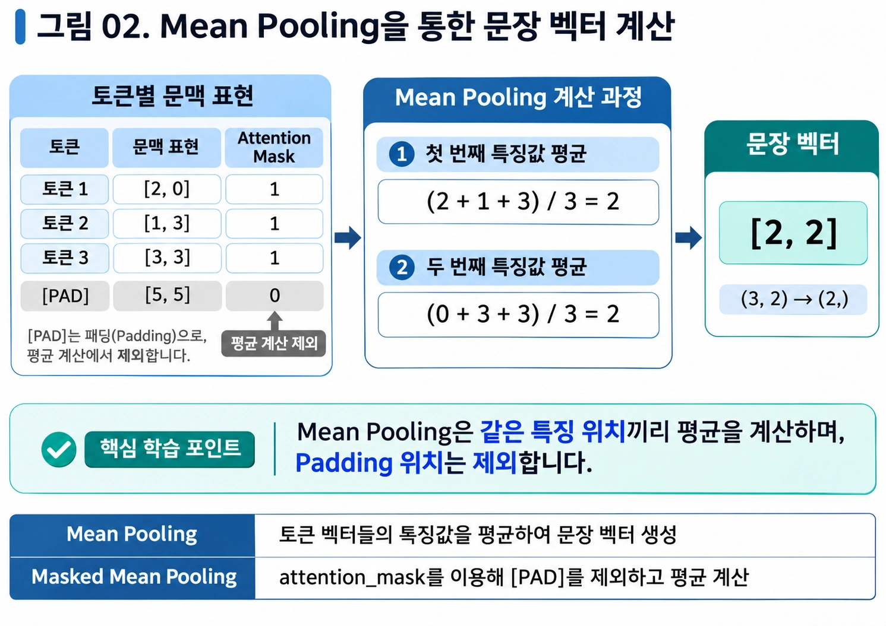
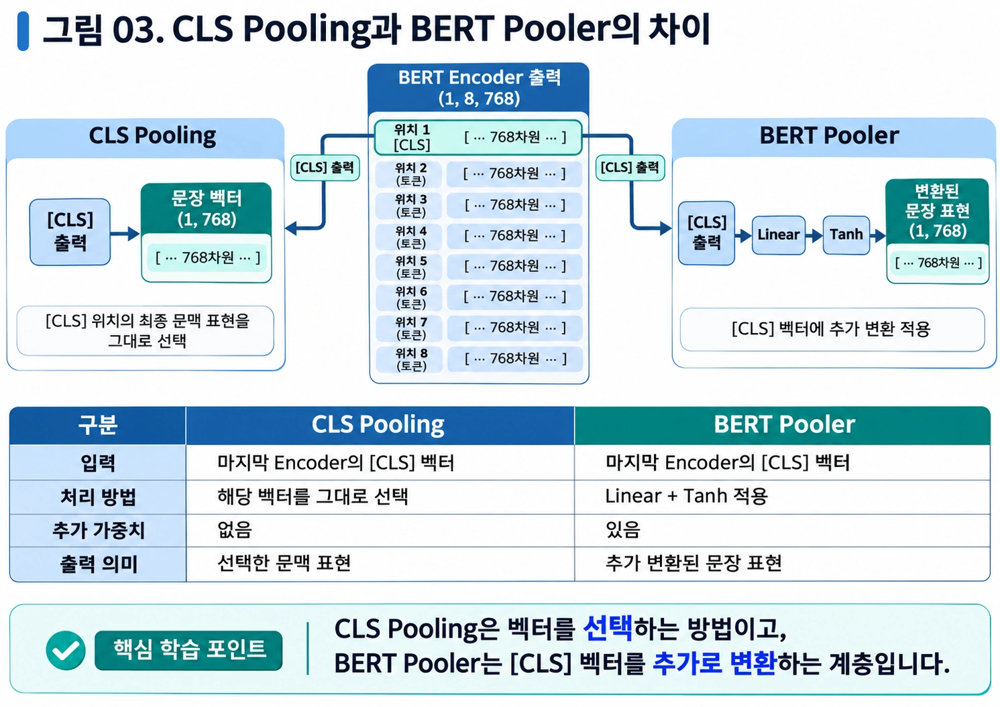
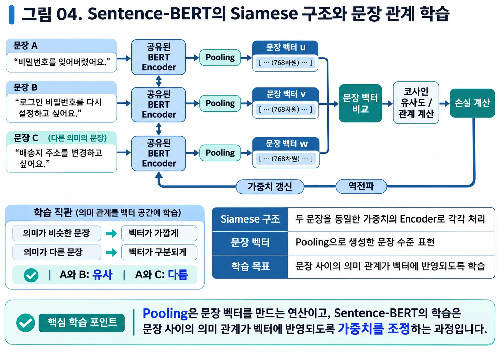
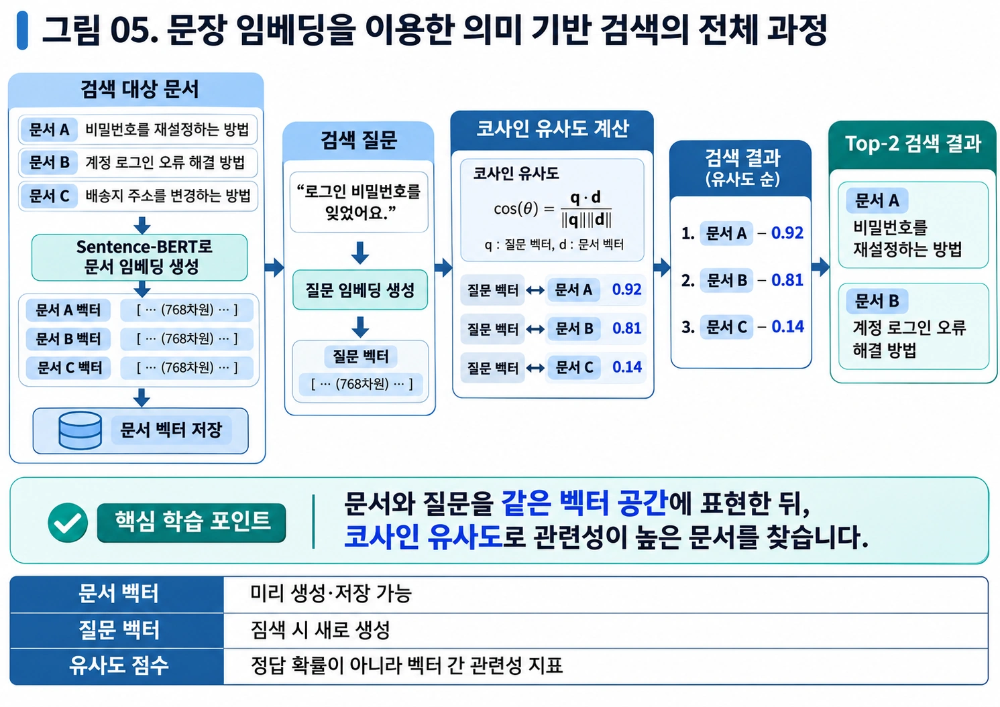

# Day 5. 문장 임베딩과 의미 기반 검색

> 길이가 다른 텍스트를 같은 크기의 벡터로 만들면 검색 질문과 문서를 비교할 수 있다. 풀링으로 문장 벡터를 만드는 과정과 Sentence-BERT가 벡터에 문장 간 관계를 반영하는 과정을 구분한다.

## 1. 토큰별 표현을 문장당 하나로 모으기

BERT 인코더의 출력에는 문장 안의 토큰 위치마다 문맥이 반영된 벡터가 하나씩 있다.
예를 들어 입력 하나에 토큰 위치가 8개라면 BERT Base 출력은 `(1, 8, 768)`이다.
문장마다 토큰 개수가 달라져도 서로 비교할 수 있도록 문장 전체를 고정 차원의 벡터로 나타낸다. 이를 <strong>문장 임베딩(Sentence Embedding)</strong>이라고 한다.

<strong>풀링(Pooling)</strong>은 토큰별 표현에서 문장당 하나의 벡터를 만드는 연산이다.
평균 풀링과 CLS 풀링은 토큰 축을 하나로 줄이는 방법이 다르며, 벡터의 특징 차원은 유지한다.
배치에서 문장당 위치 8개를 풀링하면 `(1, 8, 768)`이 `(1, 768)`로 바뀐다.

## 2. 평균 풀링과 CLS 풀링

<strong>평균 풀링(Mean Pooling)</strong>은 같은 특징 위치의 값끼리 평균을 계산한다.
예를 들어 토큰 벡터가 `[2, 0]`, `[1, 3]`, `[3, 3]`이면 첫 성분은 $(2+1+3)/3=2$, 두 번째 성분은 $(0+3+3)/3=2$다.
따라서 `(3, 2)` 모양의 토큰 배열에서 2차원 문장 벡터 `[2, 2]`를 얻는다.

배치의 길이를 맞추면서 `[PAD]` 위치의 출력 `[5, 5]`가 추가됐다고 가정한다.
네 위치를 모두 평균 내면 각각 $(6+5)/4=2.75$로 결과가 달라진다.
<strong>마스크 평균 풀링(Masked Mean Pooling)</strong>에서는 어텐션 마스크가 1인 세 위치의 값만 더하고 유효 위치 수인 3으로 나눈다. 따라서 문장 벡터는 `[2, 2]`다.
인코더의 어텐션에서 패딩을 제외하더라도 풀링 계산에는 유효 위치를 따로 반영해야 한다.

<strong>CLS 풀링(CLS Pooling)</strong>은 마지막 인코더 층의 `[CLS]` 벡터를 선택하는 방식이다.
BERT 풀러(Pooler)는 같은 벡터를 가져온 뒤 선형층과 Tanh를 적용한다.
둘 다 문장당 하나의 벡터를 반환할 수 있지만, 직접 선택한 값과 변환한 값의 특징은 다를 수 있다.
어떤 출력을 선택할지는 모델이 학습할 때 사용한 풀링 방식과 작업 목적에 맞춘다.

## 3. Sentence-BERT가 문장 사이의 관계를 학습하는 방법

BERT의 토큰 예측을 위한 사전학습만으로는, 두 문장의 벡터 거리가 의미 차이를 잘 반영한다고 보장할 수 없다.
<strong>Sentence-BERT(SBERT)</strong>는 문장 사이의 관계를 학습 목표에 반영해 의미를 비교하기 좋은 임베딩을 만든다.

<strong>샴 네트워크(Siamese Network)</strong>에서는 문장 A와 B가 같은 가중치를 쓰는 인코더를 각각 통과한다.
각각 풀링을 거쳐 문장 벡터 $u$, $v$가 되고, 두 벡터의 관계로 손실을 계산해 공유 가중치를 갱신한다.
풀링은 토큰 벡터를 모으고, 어떤 문장이 벡터 공간에서 가깝게 놓일지는 **학습 목표와 정답 데이터**가 결정한다.

| 학습 목표 | 데이터 | 학습하는 관계 |
| --- | --- | --- |
| 분류(Classification) | 자연어 추론(Natural Language Inference, NLI)의 함의, 모순, 중립 라벨 | 두 벡터와 그 차이로 문장쌍 관계를 구분 |
| 회귀(Regression) | 사람이 부여한 의미 유사도 점수 | 예측 유사도를 정답 점수에 가깝게 조정 |
| 삼중항 손실(Triplet Loss) | 기준 문장(Anchor), 유사 문장(Positive), 비유사 문장(Negative) | 기준에서 유사 문장이 비유사 문장보다 충분히 가깝도록 조정 |

예를 들어 ‘비밀번호를 잊었어요’와 ‘비밀번호를 다시 설정하고 싶어요’의 정답 유사도가 0.9이고, 모델 점수가 0.4라면 차이는 0.5다.
회귀에서 평균 제곱 오차(Mean Squared Error, MSE)를 쓰면 이 쌍의 제곱 오차는 $(0.4-0.9)^2=0.25$다.
삼중항 방식이라면 같은 기준 문장에 ‘배송지 주소를 변경하고 싶어요’ 같은 비유사 예시를 함께 사용한다.

## 4. 독립 인코딩으로 검색하기

<strong>바이 인코더(Bi-Encoder)</strong>는 질문과 문서를 독립적으로 벡터화한다. 검색 대상 문서 벡터를 미리 만들어 저장해 두고 질문이 들어왔을 때 재사용할 수 있다.
<strong>교차 인코더(Cross-Encoder)</strong>는 두 텍스트를 한 시퀀스로 넣어 토큰들이 서로를 참고한 결과로 문장쌍 점수를 구한다. 새로운 질문과 문서의 조합마다 모델 계산이 필요하다.

<strong>의미 기반 검색(Semantic Search)</strong>은 같은 표현이 없어도 의미상 관련 있는 문서를 찾는다.
‘로그인 비밀번호를 잊었어요’에 대해 키워드 일치만 보면 비밀번호를 포함한 문서 A가 눈에 띈다. 문장 임베딩으로 비교하면 계정 로그인 오류를 설명하는 문서 B도 후보에 포함될 수 있다.

1. 문서의 임베딩을 미리 계산해 저장한다.
2. 새 질문을 같은 임베딩 모델로 벡터화한다.
3. 질문 벡터와 문서 벡터 사이의 코사인 유사도(Cosine Similarity)를 계산한다.
4. 유사도가 높은 순서로 정렬하고 상위 $k$개를 반환한다.

| 문서 | 예시 유사도 | Top-2 순위 |
| --- | ---: | --- |
| A. 비밀번호 재설정 | 0.92 | 1위 |
| B. 로그인 오류 해결 | 0.81 | 2위 |
| C. 배송지 주소 변경 | 0.14 | 선정 범위 밖 |

코사인 유사도는 두 벡터의 내적을 두 벡터의 길이 곱으로 나눈 값이다.
범위는 -1부터 1까지이며, 값이 클수록 두 벡터의 방향이 비슷하다. 0.92는 두 벡터의 방향이 비슷하다는 점수로, 관련도 순위를 정하는 데 사용한다.
‘환불할 수 있다’와 ‘환불할 수 없다’는 비슷한 단어를 사용해도 답변에 필요한 의미는 달라진다. 검색 품질을 확인할 때는 실제로 반환된 문서가 질문에 필요한 정보를 제공하는지도 본다.

검색 증강 생성(Retrieval-Augmented Generation, RAG)에서는 검색된 문서나 문단을 언어모델의 응답 생성에 사용한다.
문장 임베딩은 이 과정의 검색 단계에 적용되며, FAQ 검색과 유사 문장 탐색에도 활용된다.

## 5. 핵심 개념 비교

| 개념 | 입력 처리 | 결과 |
| --- | --- | --- |
| 평균 풀링 | 유효 위치의 벡터를 특징별로 평균 | 문장 벡터 |
| CLS 풀링 | 마지막 층의 `[CLS]` 벡터를 선택 | 문장 벡터 |
| BERT 풀러 | `[CLS]`에 선형층과 Tanh를 적용 | 변환된 문장 표현 |
| 바이 인코더 | 텍스트를 각각 인코딩 | 미리 계산할 수 있는 벡터 |
| 교차 인코더 | 문장쌍을 함께 인코딩 | 쌍별 관계 점수 |

## 6. 핵심 정리

- 풀링은 길이가 다른 토큰열을 문장당 하나의 고정 차원 벡터로 바꾼다.
- 평균 풀링에서는 패딩을 제외하고 유효 위치 수로 나눈다.
- CLS 풀링은 시작 위치의 벡터를 선택하고 BERT 풀러는 이 벡터를 추가로 변환한다.
- Sentence-BERT는 문장 관계 라벨, 유사도 점수, 삼중항 등의 목표로 의미 비교에 적합한 표현을 학습한다.
- 바이 인코더로 미리 만들어 둔 문서 벡터를 재사용하고, 질문 벡터와의 유사도 순위로 상위 문서를 찾을 수 있다.
- RAG는 검색 단계에서 가져온 관련 문서 내용을 응답 생성에 사용한다.

[이전 글: BERT 텍스트 분류와 미세조정](20-BERT-텍스트-분류와-미세조정.md) | [학습 목차](README.md) | [다음 글: BERT 사전학습부터 의미 검색까지](22-BERT-사전학습부터-의미-검색까지.md)
