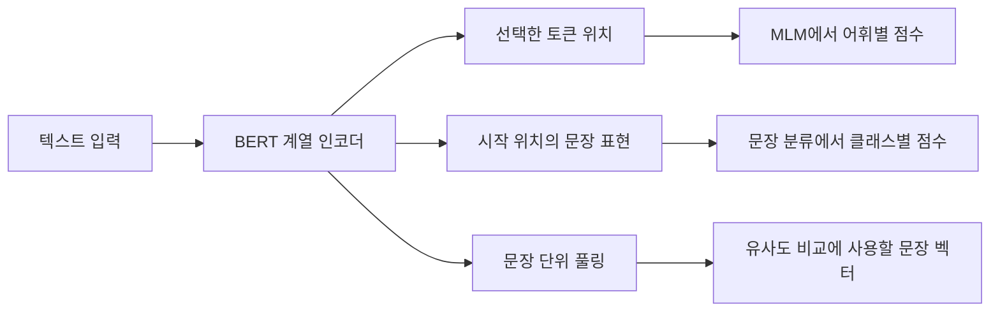
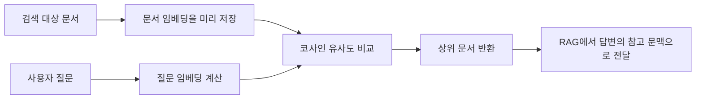

# Day 5. BERT 사전학습부터 의미 검색까지

> BERT 계열 인코더에서 출발해도 학습 목표와 출력 형태에 따라 사용 방식이 달라진다. 토큰 예측, 고객 문의 분류, 관련 문서 검색의 흐름을 비교한다.

## 1. 문맥 표현을 학습하는 단계

<strong>정적 임베딩(Static Embedding)</strong>에서는 문장이 달라도 같은 토큰에 같은 벡터를 조회한다.
BERT의 <strong>문맥 기반 표현(Contextual Representation)</strong>은 자기 어텐션으로 앞뒤 단서를 모아, ‘배를 먹었다’와 ‘배를 탔다’의 ‘배’를 서로 다른 문맥 속에서 표현한다.
이때 인코더에 넣는 벡터는 토큰, 위치, 토큰 타입 임베딩을 더한 결과이고, 인코더의 출력은 문맥을 반영해 갱신된 토큰별 벡터다.

<strong>마스크 언어 모델링(Masked Language Modeling, MLM)</strong>에서는 선택한 위치의 원래 토큰을 정답으로 삼는다.
예를 들어 `대한민국의 수도는 [MASK]입니다`에서 문맥을 활용해 ‘서울’의 어휘 점수를 높이도록 학습한다.
원래 BERT는 두 입력 구간이 원문에서 이어졌는지 분류하는 다음 문장 예측(Next Sentence Prediction, NSP)도 함께 사용했다.

SpanBERT는 마스킹 대상을 연속된 토큰 구간으로 선택한다.
<strong>구간 경계 목표(Span Boundary Objective, SBO)</strong>는 가린 구간 바깥 양쪽 경계의 표현과 내부 상대 위치에서 원래 토큰을 예측하게 한다.
같은 종류의 인코더라도 어떤 단서로 무엇을 맞히도록 학습하는지에 따라 얻는 표현이 달라진다.

## 2. 문장 표현에서 클래스별 점수 만들기

고객 문의를 배송, 결제, 환불로 분류하는 경우 정답은 전체 문장에 붙는 클래스 ID다.
BERT의 마지막 인코더 층에서 `[CLS]` 벡터를 고르고, 풀러(Pooler)와 드롭아웃(Dropout)을 거쳐 분류층에 넣는다.
분류층은 BERT Base의 768차원 표현을 3개의 로짓(Logits)으로 바꾼다.

<strong>미세조정(Fine-tuning)</strong>에서는 이 로짓을 사람이나 업무 기준이 정한 라벨과 비교한다.
교차 엔트로피 손실(Cross-Entropy Loss)을 줄이도록 새 분류 헤드와 사전학습된 BERT를 갱신한다.
전체 성능은 정확도(Accuracy)로, 클래스별 성능을 같은 비중으로 반영한 결과는 매크로 F1(Macro F1)로 볼 수 있다.
혼동행렬(Confusion Matrix)은 환불을 결제로 분류한 것처럼 오류가 집중된 클래스 쌍을 보여 준다.

## 3. 문장 자체를 비교할 벡터로 만들기

<strong>문장 임베딩(Sentence Embedding)</strong>은 검색이나 유사도 비교를 위해 문장 하나를 고정 차원의 벡터로 나타낸다.
평균 풀링(Mean Pooling)은 유효 토큰들의 표현을 특징별로 평균 내고, CLS 풀링(CLS Pooling)은 마지막 층의 `[CLS]`를 선택한다.
예를 들어 토큰 벡터가 `[2, 0]`, `[1, 3]`, `[3, 3]`이면 평균은 `[2, 2]`다. 패딩 위치는 합과 토큰 수에서 모두 제외한다.

Sentence-BERT(SBERT)는 문장 간 관계를 학습한 임베딩 모델이다.
원래 SBERT의 샴 네트워크(Siamese Network)는 가중치를 공유하는 인코더를 사용해 각 문장의 벡터를 독립적으로 생성한다.
관계 라벨로 분류하거나 유사도 점수로 회귀할 수 있고, 삼중항 손실(Triplet Loss)에서는 기준 문장에 가까워야 할 예와 멀어야 할 예를 함께 제공한다.

## 4. 학습된 임베딩을 검색에 사용하기

바이 인코더(Bi-Encoder)는 문장마다 벡터를 따로 만들므로 문서 벡터를 미리 저장할 수 있다.
교차 인코더(Cross-Encoder)는 두 문장을 함께 처리해 쌍별 관계 점수를 구한다. 문서가 달라지면 각 조합에 대한 모델 계산이 필요하다.

<strong>의미 기반 검색(Semantic Search)</strong>에서는 문서 벡터를 먼저 만들고, 새 질문이 들어오면 같은 임베딩 모델로 질문 벡터를 계산한다.
예를 들어 ‘로그인 비밀번호를 잊었어요’와 세 문서를 비교해 코사인 유사도 0.92, 0.81, 0.14를 얻었다면, Top-2 결과는 비밀번호 재설정 문서와 로그인 오류 해결 문서다.
코사인 유사도는 벡터 방향을 비교한 값이며, 이 순위는 관련 문서의 후보를 고르는 데 쓰인다.

문장 분류는 주어진 문장이 미리 정한 어느 범주인지 답한다. 의미 검색은 질문에 관련된 문서가 무엇인지 찾아 순위로 반환한다.
검색 증강 생성(Retrieval-Augmented Generation, RAG)은 검색된 문서의 내용을 언어모델이 응답을 만드는 데 사용한다.

## 5. 핵심 개념 비교

| 방법 | 학습 또는 처리 기준 | 산출물 |
| --- | --- | --- |
| BERT 사전학습 | 선택된 위치의 원래 토큰과 문장쌍의 연속 여부 | 여러 작업에 쓸 인코더 가중치 |
| SpanBERT 사전학습 | 연속 구간 마스킹과 경계에서의 토큰 예측 | 구간 표현을 학습한 인코더 |
| 문장 분류 미세조정 | 문장에 지정된 정답 클래스 | 클래스별 로짓을 내는 분류 모델 |
| Sentence-BERT 학습 | 문장쌍의 관계, 유사도 또는 삼중항 | 의미 비교에 적합한 문장 임베딩 모델 |
| 의미 기반 검색 | 학습된 모델로 얻은 질문과 문서 벡터의 유사도 | 관련성이 높은 상위 문서 |

## 6. 핵심 정리

- 문맥 표현은 입력 토큰이 주변 토큰과 맺는 관계를 벡터에 반영한다.
- 사전학습은 일반 표현을 만들고, 미세조정은 정답 라벨에 맞게 그 표현과 출력 헤드를 조정한다.
- 분류층은 문장 표현에서 클래스별 점수를 만들고, 풀링은 문장마다 비교할 벡터를 만든다.
- 풀링은 벡터를 모으는 계산이며, 문장 간 관계가 잘 드러나는 벡터를 만들려면 그 관계를 학습 목표에 반영한다.
- 의미 기반 검색은 저장된 문서 벡터와 질문 벡터를 비교해 상위 문서를 고른다. RAG에서는 이 문서가 생성에 필요한 문맥이 된다.

[이전 글: 문장 임베딩과 의미 기반 검색](21-문장-임베딩과-의미-기반-검색.md) | [학습 목차로 이동](README.md)
