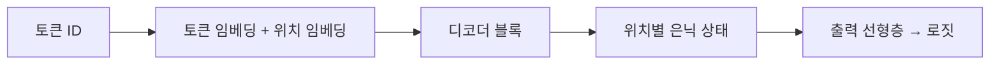

# Day 6. GPT의 구조와 다음 토큰 예측 학습

> GPT(Generative Pre-trained Transformer)는 각 위치까지의 문맥으로 바로 다음 토큰을 예측한다. ‘나는 물을 마신다’를 예로, 텍스트가 입력 벡터로 바뀌는 단계부터 정답 토큰으로 가중치를 학습하는 단계까지 따라간다.

## 1. 이전 문맥으로 다음 토큰 예측하기

N-gram 언어모델은 짧은 단어 조합의 출현 빈도로 다음 단어의 확률을 추정한다. RNN 언어모델은 이전 은닉 상태를 다음 시점에 전달하며 문맥을 누적한다. GPT는 Transformer의 Causal Self-Attention으로 현재와 이전 위치의 관계를 직접 계산한다. 학습용 토큰열이 이미 주어졌을 때는 여러 위치를 한 번의 순전파에서 처리할 수 있다.

GPT는 원본 텍스트 자체에서 각 위치의 다음 토큰을 정답으로 얻는다. 이렇게 별도의 사람 라벨 없이 원본 데이터에서 예측 목표를 만드는 방법이 <strong>자기지도 학습(Self-Supervised Learning)</strong>이다.

| 비교 항목 | BERT | GPT |
| --- | --- | --- |
| 기본 구조 | Encoder-only Transformer | Decoder-only Transformer |
| 어텐션 범위 | 입력의 앞뒤 유효 위치 | 현재 위치와 이전 유효 위치 |
| 대표 사전학습 목표 | 마스크 언어 모델링(MLM) | 다음 토큰 예측(Next Token Prediction) |
| 활용 예 | 문맥 표현을 이용한 분류 | 다음 토큰 예측을 반복하는 생성 |

원래 GPT는 라벨 없는 텍스트로 언어모델을 사전학습한 뒤, 분류나 자연어 추론처럼 정답 라벨이 있는 과제에도 미세조정했다. [Improving Language Understanding by Generative Pre-Training](https://cdn.openai.com/research-covers/language-unsupervised/language_understanding_paper.pdf)

## 2. 텍스트를 위치별 입력 벡터로 바꾸기

토크나이저(Tokenizer)가 텍스트를 토큰으로 나누고, 어휘집(Vocabulary)에서 각 토큰의 ID를 찾는다. 계산을 따라가기 위해 이 글에서는 ‘나는’, ‘물을’, ‘마신다’를 각각 토큰 하나로 둔다. 실제 토큰화에서는 단어가 여러 서브워드로 나뉠 수 있다.

| 토큰 | `[BOS]` | 나는 | 물을 | 마신다 | 먹는다 | `[EOS]` |
| --- | --- | --- | --- | --- | --- | --- |
| Token ID | 0 | 1 | 2 | 3 | 4 | 5 |

`[BOS]`는 시작 토큰(Beginning of Sequence), `[EOS]`는 종료 토큰(End of Sequence)이다. 이 표의 기호와 번호는 설명용이다. 입력 `[BOS] 나는 물을 마신다`의 ID는 `[0, 1, 2, 3]`이다.

<strong>토큰 임베딩(Token Embedding)</strong>은 ID를 행 번호로 삼아 학습 가능한 임베딩 표에서 벡터를 조회한다. 원래 GPT는 같은 길이의 <strong>위치 임베딩(Position Embedding)</strong>을 위치별로 조회해 토큰 벡터에 더했다. 위치 정보를 반영하는 방식은 모델마다 달라질 수 있다.

## 3. Decoder-only 블록에서 허용된 문맥만 읽기

원래 Encoder-Decoder Transformer에서는 디코더가 Cross-Attention으로 인코더 출력을 읽는다. GPT의 Decoder-only 구조는 하나의 토큰열을 디코더 블록에 입력한다. 각 블록은 그 토큰열에서 Query, Key, Value를 만들고 Causal Self-Attention으로 문맥을 계산한다.

| Query 위치 | 참조 가능한 Key와 Value | 다음 토큰 정답 |
| --- | --- | --- |
| `[BOS]` | `[BOS]` | 나는 |
| 나는 | `[BOS]`, 나는 | 물을 |
| 물을 | `[BOS]`, 나는, 물을 | 마신다 |
| 마신다 | `[BOS]`, 나는, 물을, 마신다 | `[EOS]` |

‘물을’ 위치가 뒤쪽의 ‘마신다’를 참조하면 정답이 입력에서 새어 들어온다. <strong>인과 마스크(Causal Mask)</strong>는 각 Query보다 뒤에 있는 Key의 점수를 Softmax 전에 마스킹한다. 그 결과 미래 위치의 가중치가 0이 되고, 현재까지의 Value만 가중합에 들어간다.

<strong>위치별 순전파 신경망(Position-wise Feed-Forward Network, FFN)</strong>은 어텐션을 거친 벡터에 같은 변환을 위치마다 적용한다. 잔차 연결(Residual Connection)은 하위 층의 입력을 출력에 더하고, 층 정규화(Layer Normalization)는 위치별 특성 값을 정규화한다. 블록을 쌓을 때 앞 블록의 출력이 다음 블록의 입력이 된다.

## 4. 은닉 상태를 어휘별 로짓으로 바꾸기

마지막 블록이 만든 <strong>은닉 상태(Hidden State)</strong>는 각 위치까지의 문맥을 담는다. 출력 선형층(Output Linear, Vocabulary Projection)은 이 벡터를 어휘집 크기의 점수 벡터로 변환한다. FFN은 블록 안에서 특성을 변환하고, 출력 선형층은 최종 벡터에서 예측 점수를 만든다.

| 처리 단계 | 텐서 형태 | 예시 |
| --- | --- | --- |
| 입력 토큰 ID | 배치 크기 × 시퀀스 길이 | `(1, 4)` |
| 임베딩과 위치 정보 결합 | 배치 크기 × 시퀀스 길이 × 은닉 차원 | `(1, 4, 4)` |
| 마지막 디코더 블록 출력 | 배치 크기 × 시퀀스 길이 × 은닉 차원 | `(1, 4, 4)` |
| 출력 선형층의 로짓(Logits) | 배치 크기 × 시퀀스 길이 × 어휘집 크기 | `(1, 4, 6)` |

‘물을’ 위치에는 여섯 어휘의 로짓이 있다. 어휘 축에 Softmax를 적용하면 합이 1인 다음 토큰 분포가 된다. 아래는 그 위치에서 나올 수 있는 가상 예측이다.

| 후보 | 마신다 | 먹는다 | 나는 | 물을 | `[EOS]` | `[BOS]` |
| --- | --- | --- | --- | --- | --- | --- |
| 확률 | 0.65 | 0.20 | 0.06 | 0.05 | 0.03 | 0.01 |

## 5. 입력을 한 칸 옮긴 정답으로 가중치 학습하기

전체 토큰열을 `[BOS] 나는 물을 마신다 [EOS]`로 두면, 입력은 마지막 토큰을 빼고, 정답은 첫 토큰을 빼서 만든다. 두 시퀀스를 위치별로 나란히 놓으면 현재 위치의 출력과 바로 다음 토큰을 비교할 수 있다.

| 위치 | 1 | 2 | 3 | 4 |
| --- | --- | --- | --- | --- |
| 입력 | `[BOS]` | 나는 | 물을 | 마신다 |
| 정답 | 나는 | 물을 | 마신다 | `[EOS]` |

입력에는 원문에서 관측한 토큰들이 모두 제공된다. Causal Mask가 뒤쪽 위치를 가리므로, 현재 위치까지의 문맥만 사용하면서 네 위치의 로짓을 병렬로 계산할 수 있다.

교차 엔트로피 계산과 가중치 갱신

<strong>교차 엔트로피 손실(Cross-Entropy Loss)</strong>은 위치마다 정답 토큰에 부여한 확률의 음의 자연로그를 구한다. ‘물을’ 위치의 정답인 ‘마신다’에 확률 0.65를 부여했다면 이 위치의 손실은 `−ln(0.65) ≈ 0.431`이다. 정답 확률이 높아질수록 손실은 작아진다.

1. <strong>순전파(Forward Propagation)</strong>에서 네 위치의 로짓을 계산한다.
2. <strong>손실 계산(Loss Computation)</strong>에서 각 위치의 로짓과 정답 ID를 비교하고, 예측 대상 위치들의 손실을 평균 낸다. 로짓을 받는 교차 엔트로피 구현은 로그 소프트맥스(Log-Softmax) 계산을 내부에서 처리한다.
3. <strong>역전파(Backpropagation)</strong>에서 임베딩, 어텐션, FFN, 출력 선형층 등 학습 가능한 파라미터에 대한 손실의 기울기(Gradient)를 구한다.
4. <strong>옵티마이저(Optimizer)</strong>가 이 기울기를 사용해 가중치를 갱신한다.

## 용어 정리

| 용어 | 이 글에서의 뜻 |
| --- | --- |
| Decoder-only Transformer | 하나의 토큰열에 Causal Self-Attention을 적용하는 디코더 블록 기반 구조 |
| Causal Self-Attention / Causal Mask | 현재와 이전 위치를 읽는 어텐션과, 미래 위치를 가려 그 참조 범위를 만드는 마스크 |
| Hidden State / Vocabulary Projection | 위치별 문맥 벡터와, 이를 어휘별 점수로 변환하는 출력 선형층 |
| Logits / Softmax | 확률로 변환하기 전의 점수와, 이를 합이 1인 확률분포로 바꾸는 함수 |
| Next Token Prediction | 현재까지의 토큰을 조건으로 바로 뒤의 토큰을 예측하는 학습 목표 |
| Cross-Entropy Loss / Backpropagation | 정답 예측 오류를 수치화하는 손실과, 가중치별 손실 기울기를 구하는 계산 |

[이전 글: BERT 사전학습부터 의미 검색까지](22-BERT-사전학습부터-의미-검색까지.md) | [학습 목차](README.md) | [다음 글: GPT의 텍스트 생성 원리와 생성 제어](24-GPT의-텍스트-생성-원리와-생성-제어.md)
