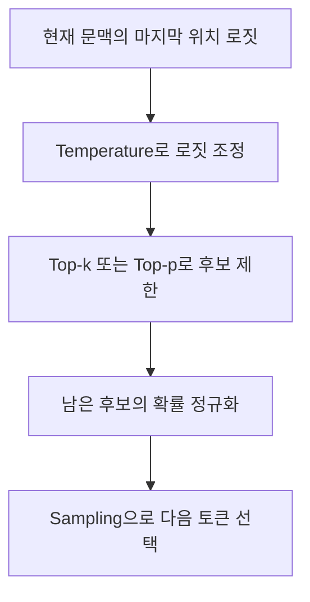

# Day 6. GPT의 텍스트 생성 원리와 생성 제어

> 학습된 GPT는 현재 입력의 마지막 위치에서 다음 토큰의 점수를 계산한다. 선택한 토큰을 입력 끝에 붙이고 같은 계산을 반복하면 프롬프트에 이어지는 텍스트가 만들어진다.

## 1. 프롬프트에서 첫 토큰 고르기

<strong>프롬프트(Prompt)</strong>는 생성의 시작 문맥이다. 앞 글과 같은 설명용 어휘집에서 `[BOS] 나는`을 입력하면 토크나이저가 토큰 ID `[0, 1]`을 만든다. 입력은 임베딩 층과 디코더 블록을 지나고, 출력 선형층이 위치마다 어휘별 로짓을 계산한다.

배치 크기가 1, 토큰이 2개, 어휘가 6개라면 로짓의 형태는 `(1, 2, 6)`이다. 첫 위치는 `[BOS]` 뒤의 토큰을 예측한다. 현재 프롬프트 전체 뒤에 이어질 토큰을 고르려면 마지막 위치인 ‘나는’에서 나온 여섯 로짓을 사용한다.

## 2. 선택한 토큰을 다시 입력에 붙이기

<strong>자기회귀 생성(Autoregressive Generation)</strong>은 이전에 주어졌거나 생성한 토큰으로 다음 토큰을 예측하고, 선택한 토큰을 새 문맥에 넣는 방식이다.

| 생성 단계 | 현재 문맥 | 선택한 토큰의 예 |
| --- | --- | --- |
| 1 | `[BOS] 나는` | 물을 |
| 2 | `[BOS] 나는 물을` | 마신다 |
| 3 | `[BOS] 나는 물을 마신다` | `[EOS]` |

처음에 ‘물을’을 고르면 다음 분포는 ‘나는 물을’이라는 새 문맥을 조건으로 계산한다. 이미 계산한 Key와 Value를 KV Cache에 저장하면 이전 토큰에 대한 계산의 일부를 재사용할 수 있다.

생성은 종료 토큰(End of Sequence, EOS)이 선택되거나 최대 생성 토큰 수에 도달하면 멈춘다. 토크나이저의 디코딩(Detokenization)이 출력 ID를 텍스트로 되돌린다. 예시의 시작과 종료 기호를 제외하면 ‘나는 물을 마신다’가 남는다.

| 구분 | 학습(Training) | 추론(Inference) |
| --- | --- | --- |
| 입력 문맥 | 원본 텍스트에서 만든 토큰열 | 프롬프트와 그동안 선택한 토큰 |
| 다음 토큰 | 원본의 다음 토큰을 정답으로 사용 | 디코딩 규칙으로 후보 하나를 선택 |
| 계산 순서 | 여러 위치의 예측과 손실을 한 번에 계산 | 새 토큰을 하나씩 선택 |
| 파라미터 | 손실을 기준으로 갱신 | 학습한 가중치를 고정해 사용 |

## 3. Greedy Decoding과 Sampling 비교하기

현재 입력이 `[BOS] 나는 물을`이면, 마지막 위치의 로짓에 Softmax를 적용해 아래와 같은 분포를 얻었다고 하자.

| 후보 | 마신다 | 먹는다 | 나는 | 물을 | `[EOS]` | `[BOS]` |
| --- | --- | --- | --- | --- | --- | --- |
| 확률 | 0.65 | 0.20 | 0.06 | 0.05 | 0.03 | 0.01 |

<strong>탐욕 디코딩(Greedy Decoding)</strong>은 매 단계에서 점수가 가장 높은 토큰을 고른다. 이 분포에서는 ‘마신다’를 선택한다. 선택 기준과 나머지 조건이 같으면 같은 결과를 얻을 수 있다. 매 단계의 선택은 그 시점의 확률만 기준으로 삼는다.

<strong>확률적 샘플링(Sampling)</strong>은 분포에 따라 토큰을 추첨한다. 같은 분포에서 독립적으로 여러 번 추첨하면 선택 비율은 ‘마신다’ 65%, ‘먹는다’ 20%에 가까워진다. 한 번의 생성에서 다른 토큰을 고르면 이후 단계의 문맥과 확률도 달라진다.

## 4. Temperature로 확률의 집중도 바꾸기

Temperature `T`는 <strong>Softmax에 넣기 전의 로짓</strong>을 조절한다. 로짓 벡터를 `T`로 나눈 뒤 어휘 축에 Softmax를 적용한다.

- `T = 1`이면 원래 분포를 유지한다.
- `0 < T < 1`이면 로짓의 차이가 커져 높은 점수의 토큰에 확률이 집중된다.
- `T > 1`이면 로짓의 차이가 작아져 확률이 더 고르게 분배된다.

양의 Temperature는 후보의 순위를 유지한다. 따라서 같은 로짓에서 가장 높은 점수 하나만 고르는 Greedy Decoding의 선택은 동일하다. Sampling에서는 각 후보가 선택될 확률이 달라진다.

같은 로짓에 세 가지 Temperature를 적용한 계산

원래 확률만 주어져도 각 확률을 `1 / T` 거듭제곱한 뒤, 변환된 값의 합으로 나누면 같은 결과를 얻는다. 예를 들어 `T = 0.5`에서는 확률을 각각 제곱한다. ‘마신다’는 제곱값 `0.4225`를 전체 후보의 제곱값 합 `0.4696`으로 나누어 약 0.900이 된다.

| 후보 | T = 0.5 | T = 1.0 | T = 2.0 |
| --- | ---: | ---: | ---: |
| 마신다 | 0.900 | 0.650 | 0.404 |
| 먹는다 | 0.085 | 0.200 | 0.224 |
| 나머지 네 토큰의 합 | 0.015 | 0.150 | 0.372 |

## 5. Top-k와 Top-p로 선택 후보 제한하기

<strong>Top-k Sampling</strong>은 확률이 높은 상위 `k`개를 남긴다. 예시에서 `k = 2`라면 ‘마신다’와 ‘먹는다’를 남겨 두 확률의 합 0.85로 각각 나눈다. 재정규화한 분포는 약 0.765와 0.235다.

<strong>Top-p Sampling(Nucleus Sampling)</strong>은 확률이 높은 순으로 더해, 누적 확률이 `p` 이상인 최소 후보 집합을 고른다. 예시에서 `p = 0.90`이면 세 번째 후보를 더하는 순간 누적 확률이 0.91에 처음 도달한다. 분포가 달라지면 같은 `p`에서 남는 토큰 수가 달라질 수 있다. [The Curious Case of Neural Text Degeneration](https://arxiv.org/abs/1904.09751)

| 후보 | 원래 확률 | 누적 확률 | Top-k (`k` = 2) | Top-p (`p` = 0.90) |
| --- | ---: | ---: | --- | --- |
| 마신다 | 0.65 | 0.65 | 포함 | 포함 |
| 먹는다 | 0.20 | 0.85 | 포함 | 포함 |
| 나는 | 0.06 | 0.91 | 제외 | 포함 |
| 물을 | 0.05 | 0.96 | 제외 | 제외 |
| `[EOS]` | 0.03 | 0.99 | 제외 | 제외 |
| `[BOS]` | 0.01 | 1.00 | 제외 | 제외 |

Top-p에서 남은 세 후보는 원래 확률을 각각 0.91로 나눈 약 0.714, 0.220, 0.066으로 샘플링한다. 비교표의 두 필터는 같은 원래 분포에 각각 적용한 결과다.

## 6. 생성 설정을 함께 적용하기

Temperature를 먼저 적용하면 Top-k는 조정된 로짓 순위를, Top-p는 조정된 확률의 누적값을 기준으로 후보를 제한한다. 이후 남은 후보의 확률을 다시 합이 1이 되도록 맞추고 샘플링한다. 아래는 필터를 적용하는 한 가지 흐름이다.

이 설정들은 추론 단계의 토큰 선택을 조절한다. 모델의 응답을 추가 학습으로 바꾸는 방법은 다음 글의 SFT, RLHF, DPO에서 다룬다.

## 용어 정리

| 용어 | 이 글에서의 뜻 |
| --- | --- |
| Prompt / Autoregressive Generation | 생성에 주는 시작 문맥과, 고른 토큰을 이어 붙이며 다음 토큰을 예측하는 방식 |
| EOS / 최대 생성 토큰 수 | 각각 모델이 선택한 종료 신호와 새로 생성할 토큰 수의 상한 |
| Greedy Decoding / Sampling | 최고 점수의 토큰을 선택하는 방법과 후보 확률에 따라 추첨하는 방법 |
| Temperature | 로짓을 양수로 나누어 다음 토큰 분포의 집중도를 조절하는 값 |
| Top-k / Top-p | 후보를 개수로 제한하는 필터와 누적 확률로 제한하는 필터 |
| 재정규화(Renormalization) | 남은 후보의 확률 합이 1이 되도록 각 확률을 조정하는 계산 |

[이전 글: GPT의 구조와 다음 토큰 예측 학습](23-GPT의-구조와-다음-토큰-예측-학습.md) | [학습 목차](README.md) | [다음 글: NLP 기초부터 LLM까지](25-NLP-기초부터-LLM까지.md)
